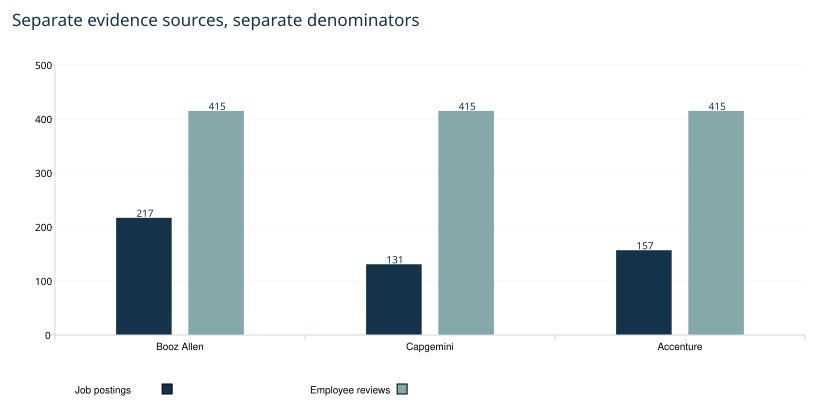
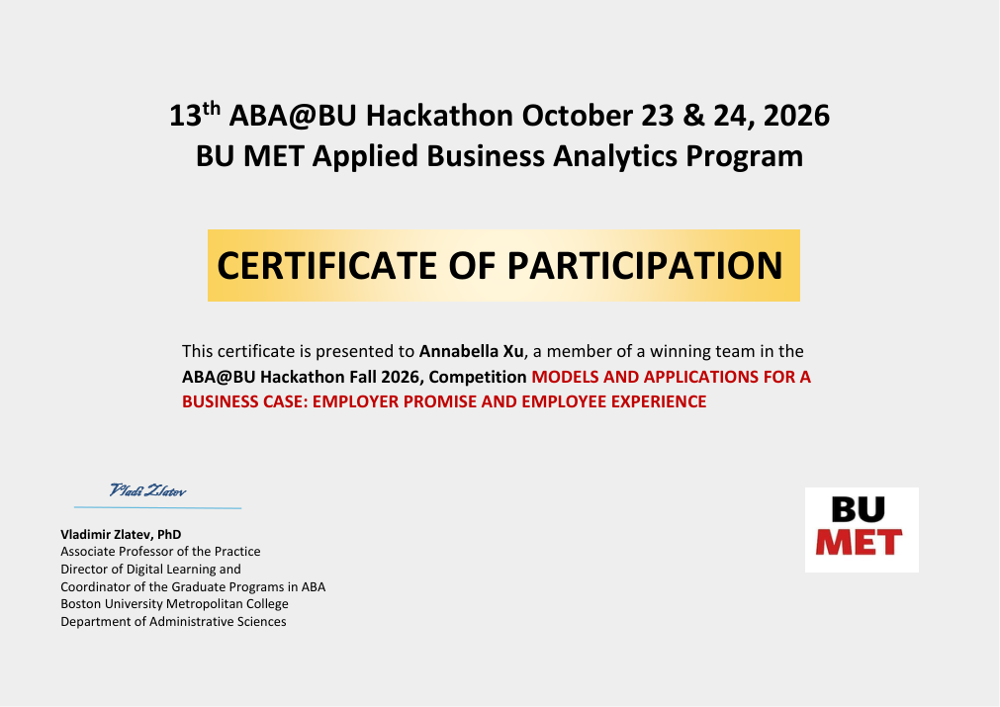

::: {.eyebrow}
ABA@BU Hackathon · Winning team member · October 23–24, 2026
:::

# Employer promise and employee experience

::: {.page-intro}
A team project examining how recruitment messages compare with employee feedback, and what that comparison can tell early-career candidates.
:::

::: {.case-summary}
**Focal employer:** Booz Allen Hamilton. **Peer benchmarks:** Accenture and Capgemini.

I was a member of a winning team in the **13th ABA@BU Hackathon**, hosted by Boston University Metropolitan College's Applied Business Analytics Program. The competition was *Models and Applications for a Business Case: Employer Promise and Employee Experience*.

[View the winning-team certificate (PDF)](assets/hackathon/ABA-BU-Winning-Team-Certificate.pdf)
:::

## The business question

How could Booz Allen Hamilton improve its recruitment information and employment offering for early-career talent? We examined its job postings and employee reviews, then used Accenture and Capgemini as comparison firms to understand which themes stood out.

## My contribution

I cleaned **505 job postings and 1,245 employee reviews**, removing HTML artifacts, standardizing missing values, and checking duplicate IDs and rating consistency. I contributed to comparing employer promises with employee feedback and developing recommendations for clearer recruitment information and project-transition support.

The findings and recommendations below describe the team's work.

## Evidence and analytical approach

The sample contained **217 Booz Allen postings, 157 Accenture postings, and 131 Capgemini postings**, with **415 employee reviews per company**. We aggregated postings and reviews separately by company and theme, preserving each source's denominator rather than treating them as matched employee–vacancy pairs.

::: {.case-figure}
{width=100% loading=lazy fig-alt="Source-specific sample sizes: Booz Allen 217 postings and 415 reviews; Capgemini 131 postings and 415 reviews; Accenture 157 postings and 415 reviews."}
:::

The team's text-label framework covered employer promises, working conditions, and nine dimensions of employee sentiment. We first established a posting-only baseline, then examined how employee reviews supported or qualified that picture.

## What the comparison showed

- **Booz Allen Hamilton:** advertised learning and benefits, together with positive work-life signals in reviews, coexisted with employee concerns about project stability and management. The practical question was how clearly candidates understood project transitions and available support.
- **Accenture:** career-growth messaging was considered alongside review concerns about advancement, pay, and workload. We treated this as potential tension within the sample, rather than proof of an experience shared by every employee.
- **Capgemini:** flexibility and work-life signals showed some alignment, while conclusions about career growth and pay changed with the review-title mix. A sensitivity check excluded I-CAP/onboarding-related titles, leaving 172 reviews under the broader exclusion rule; it did not establish that those excluded reviews were invalid.

## Recommendations

**Clearer, role-specific recruitment information.** Explain the actual work arrangement, requirements, benefits eligibility, and application process. Feature strengths that can be verified for the specific role. Proposed measures included posting completeness and qualified application completion.

**Career and project-transition transparency.** Explain pay and promotion criteria, project dependencies, reassignment support, and transferable skills. These were proposed improvements, rather than claims about an existing company policy. Suggested measures included candidate comprehension, expectation match, and time to reassignment.

## Validation and interpretation

The presentation included a **30-passage check spanning 270 dimension-level label comparisons**. Its reference labels were assistant-assigned, so the reported agreement was a preliminary diagnostic rather than independently human-validated model accuracy.

The data were historical and the companies differed in role, location, date, and review composition. Employee accounts were not verified descriptions of every role, and the files contained no hiring or retention outcomes. Our recommendations therefore included future measurement rather than claims of proven recruitment uplift.

## Recognition

::: {.certificate-preview}
[{width=100% loading=lazy fig-alt="Certificate presented to Annabella Xu, a member of a winning team in the ABA@BU Hackathon Fall 2026, Employer Promise and Employee Experience competition."}](assets/hackathon/ABA-BU-Winning-Team-Certificate.pdf)
:::

[Back to all projects](projects.qmd) · [Contact me](contact.qmd)
