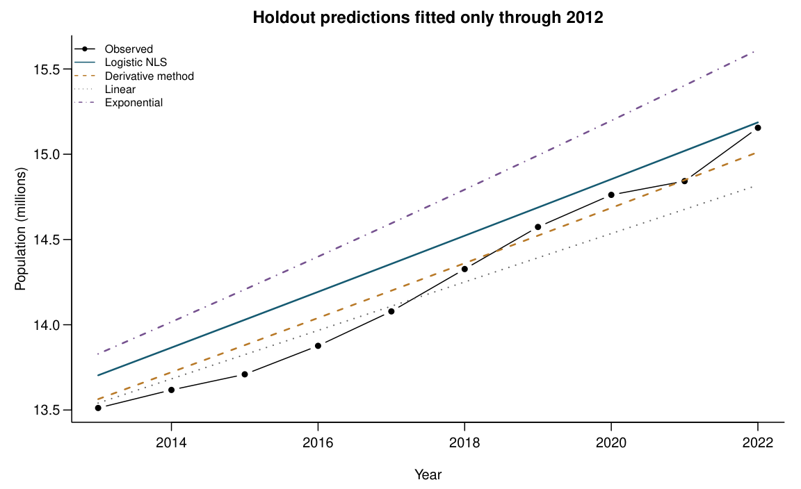

::: {.eyebrow}
R · Mathematical modeling · Historical forecast validation
:::

# Ontario population modeling

::: {.page-intro}
A course project in logistic population modeling, followed by a November 2026 reconstruction that tested how well the model predicted years excluded from fitting.
:::

## Original course project

In **January–May 2023**, I collaborated in a **five-member Introduction to Modelling team** at McMaster University. My contributions included assumptions, variable organization, and interpretation of Ontario population trends.

## Reconstructed R analysis

In **November 2026**, I reconstructed the analysis using Statistics Canada's July 1 population estimates: **52 annual observations from 1971–2022**. The original report was not recovered, so the estimates, validation results, and figure on this page belong to the reconstruction.

The model uses total population. Births, deaths, and migration provide demographic context; the fitted model does not estimate their separate effects.

I compared two logistic estimation approaches—**numerical differentiation** and **nonlinear least squares**—with linear and exponential trends. Models were fitted to **1971–2012** and evaluated on **2013–2022**, a fixed ten-year holdout.

## Results on the ten-year holdout

| Model | Mean absolute percentage error | RMSE, persons |
|---|---:|---:|
| Logistic, numerical differentiation | **0.65%** | **106,940** |
| Linear trend | 0.90% | 160,538 |
| Logistic, nonlinear least squares | 1.40% | 217,040 |
| Exponential trend | 3.22% | 464,074 |

Percentages and errors are rounded from the executed R results. Lower values indicate smaller errors on this specific holdout.

::: {.case-figure}
{width=100% loading=lazy fig-alt="Observed Ontario population compared with nonlinear logistic, derivative-based logistic, linear, and exponential predictions over 2013–2022. Every model was fitted only through 2012."}
:::

The nonlinear logistic model fitted the full historical sample most closely, but the derivative-based model performed best on the holdout. This distinction showed why historical goodness of fit alone was insufficient for choosing a forecasting method.

## Model limits

Results were sensitive to the fitting window, and the logistic asymptote should not be interpreted as Ontario's physical population capacity. Residual dependence and underprediction of later population growth further limited the model's usefulness as a current forecast. One ten-year holdout did not establish that a method would remain best in other periods.

The reconstruction used revised historical estimates downloaded in November 2026. It was a retrospective modeling exercise rather than a forecast made with the data vintage available in 2023.

**Data source:** [Statistics Canada, Table 17-10-0005-01](https://doi.org/10.25318/1710000501-eng), Ontario, all ages, total gender, July 1 population. Numerical results were checked against the reconstructed report and exported R tables.

[Back to all projects](projects.qmd) · [View my CV](cv.qmd)
