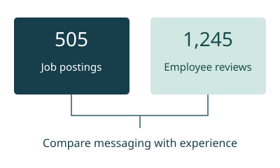
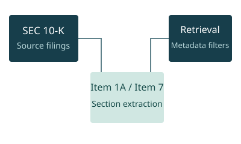
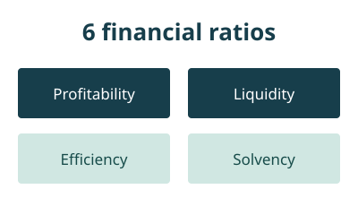
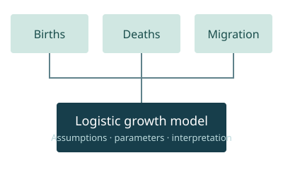

# Selected projects

::: {.page-intro}
Academic and team projects connecting finance, business questions, and data. Each summary describes the project context and my work; the diagrams show workflows and analytical frameworks.
:::

::: {.project #employer-branding}
::: {.project-visual}
{width=400 height=240 loading=lazy fig-alt="Comparing 505 job postings with 1,245 employee reviews to examine employer messaging and employee experience."}
:::
::: {.project-content}
## Employer branding and employee review analysis

::: {.project-meta}
ABA@BU Hackathon · Winning team member · October 23–24, 2026
:::

**Question:** How does employer messaging compare with what employees report about their experience?

I cleaned **505 job postings and 1,245 employee reviews**, removing HTML artifacts, standardizing missing values, checking duplicate IDs, and reviewing rating consistency. Our team focused on **Booz Allen Hamilton**, using **Accenture and Capgemini** as peer benchmarks.

The analysis informed recommendations for clearer recruitment information and project-transition support. I was a member of a winning team in the Employer Promise and Employee Experience competition.

[Read the case study](hackathon.qmd) · [View the certificate](assets/hackathon/ABA-BU-Winning-Team-Certificate.pdf)

::: {.tag-list}
[Python]{.tag} [Data quality]{.tag} [Text analysis]{.tag} [Business recommendations]{.tag}
:::
:::
:::

::: {.project #sec-retrieval}
::: {.project-visual}
{width=400 height=240 loading=lazy fig-alt="SEC filings are separated into Item 1A and Item 7 sections, then organized with metadata for filtered retrieval."}
:::
::: {.project-content}
## SEC 10-K extraction and retrieval

::: {.project-meta}
Applied Generative AI for Business Analytics · Group project · January–May 2026
:::

**Question:** How can a large collection of corporate filings be organized for relevant, traceable financial research?

I worked on processing **7,754 SEC 10-K filings from 2024 across seven SIC industry groups**. The workflow included text cleaning, section extraction, sentence segmentation, and metadata organization.

The project extracted **Item 1A (Risk Factors)** and **Item 7 (Management's Discussion and Analysis)**. A retrieval pipeline used structured metadata and section filters to support focused searches and source traceability.

This work connected document processing with the information needs of financial and risk analysis.

::: {.tag-list}
[Python]{.tag} [SEC filings]{.tag} [Metadata]{.tag} [Retrieval / RAG]{.tag}
:::
:::
:::

::: {.project #financial-analysis}
::: {.project-visual}
{width=400 height=240 loading=lazy fig-alt="Financial analysis framework covering profitability, liquidity, efficiency, and solvency. The diagram shows categories, not measured company results."}
:::
::: {.project-content}
## L'Oréal and Estée Lauder financial analysis

::: {.project-meta}
Financial and Managerial Accounting · Group project · September–October 2025
:::

**Question:** What do financial statements reveal about the performance and financial position of two beauty companies?

Our group compared L'Oréal and Estée Lauder's financial statements. I analyzed **six financial ratios**, using L'Oréal's **2024 and first-half 2025** data to help inform an investment recommendation.

The comparison considered profitability, liquidity, operating efficiency, and solvency. It strengthened my ability to interpret accounting measures in a company and industry context, and to communicate the reasoning behind a financial conclusion.

::: {.tag-list}
[Excel]{.tag} [Financial statements]{.tag} [Ratio analysis]{.tag} [Investment research]{.tag}
:::
:::
:::

::: {.project #population-modeling}
::: {.project-visual}
{width=400 height=240 loading=lazy fig-alt="Conceptual population modeling framework linking births, deaths, and migration with a logistic growth model; no estimated forecast is shown."}
:::
::: {.project-content}
## Ontario population growth modeling

::: {.project-meta}
Introduction to Modelling · Group project · January–May 2023
:::

**Question:** How can a mathematical model help interpret long-term population trends in Ontario?

I collaborated in a **five-member team** developing a logistic population growth model. My contributions included model assumptions, variable organization, and interpretation of demographic trends.

In **November 2026**, I reconstructed the R analysis using **52 annual Statistics Canada observations (1971–2022)** and fitted logistic models with numerical differentiation and nonlinear least squares. Four models were compared on a **ten-year holdout (2013–2022)**: derivative-based logistic achieved **0.65% MAPE**, versus **0.90%** for a linear trend.

These estimates belong to the 2026 reconstruction. The original 2023 project contributions remain distinct.

[Explore the reconstructed analysis and validation](population.qmd)

::: {.tag-list}
[R]{.tag} [Mathematical modeling]{.tag} [Demographics]{.tag} [Least squares]{.tag}
:::
:::
:::

## Let's talk about the work

Interested in a project or my approach to analysis? [Contact me](contact.qmd) to start a conversation.
